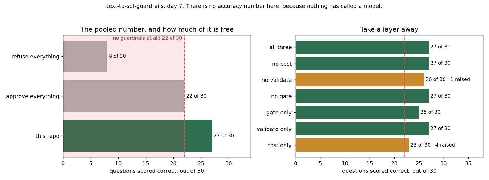

# text-to-sql-guardrails

Ask a question in English, get SQL and have the agent refuse the query before it runs if
it is unsafe or too expensive. The guardrails are the product. The generation is the easy
part.

The agent runs end to end against a scripted generator, because no model is reachable from
the environment this is built in.

**There is no accuracy number in this repo and there cannot be one.** Accuracy on a text
to SQL set is a property of the thing writing the SQL, and nothing here has ever called a
model. So the guard is what gets scored instead. Across all 30 frozen questions the guard
gets 27, and a system with no guardrails at all gets 22. That gap of five questions is what
every layer in here is worth put together. `docs/adr-0011` is the whole argument.

```
python3 scripts/build_warehouse.py   --db /tmp/wh.duckdb
python3 scripts/check_gold.py        --db /tmp/wh.duckdb
python3 -m tests.run_all             --db /tmp/wh.duckdb
python3 scripts/retrieval_report.py  --db /tmp/wh.duckdb --json /tmp/r.json
python3 scripts/validation_report.py --db /tmp/wh.duckdb --json /tmp/v.json
python3 scripts/cost_report.py       --db /tmp/wh.duckdb --json /tmp/c.json
python3 scripts/trace_report.py      --db /tmp/wh.duckdb
python3 scripts/scorecard_report.py  --db /tmp/wh.duckdb --json /tmp/s.json
```

`requirements.txt` is duckdb and matplotlib. The embedding scorer needs
`requirements-dense.txt` on top, which is roughly 500 MB of wheels and a 130 MB model
download. Everything except that scorer runs without them and the report prints a line
saying it ran without them rather than quietly showing a shorter table.

The database goes outside the repo when this runs in a sandbox. A DuckDB checkpoint
unlinks its write ahead log and some mounts refuse unlink. On a laptop the default path
`warehouse/retail.duckdb` is fine.

## What is here

```
warehouse/schema.sql     18 tables, 111 columns, retail order model
warehouse/seed.py        deterministic generator, one seeded Random
warehouse/catalog.py     reads the catalog out of the live database
warehouse/adapter.py     DuckDB and Snowflake dialect records
evals/questions.jsonl    30 questions, frozen
evals/gold.py            runs the gold SQL, canonicalises a result set
evals/collision.py       how often two questions share an answer
evals/power.py           smallest difference this set could detect
evals/freeze.py          the hash that stops the questions moving
evals/power.py           smallest detectable difference, and the sign flip test
retrieval/relevance.py   which tables a question needs, read out of the gold sql
retrieval/lexical.py     idf weighted word overlap, no model
retrieval/dense.py       bge-small over the same table text
retrieval/graph.py       join edges inferred from primary key naming
retrieval/select.py      top k, join expansion, and what the prompt costs
agent/role.py            the read-only role, and the gate that has to sit in front of it
agent/prompt.py          prompt construction, in named sections that can be measured
agent/generate.py        the generator interface, and parsing what comes back
agent/pipeline.py        one attempt in `answer`, the correction loop in `solve`
agent/validate.py        static validation against the catalog the query will run on
agent/cost.py            reads a plan, and the ceiling it is judged against
agent/guard.py           gate then validate then cost, the only door to the connection
agent/correct.py         one retry strategy per refusal code, derived from the source
agent/trace.py           every attempt and every correction, and a text renderer
evals/reach.py           which refusal codes anything but a test actually produces
evals/scorecard.py       all 30 questions, the two degenerate arms, and the ablation
scripts/role_probe.py    what a read-only connection actually blocks
scripts/validation_report.py  what each layer catches, and what ran without it
scripts/cost_report.py   the answer key, the two candidate metrics, and the probes
scripts/trace_report.py  the policy, what a retry costs, and what reaches it
scripts/scorecard_report.py  every question, the floor, and what each layer is worth
docs/adr-00*.md          eleven decisions, with what each one costs
```

## Results

The guard is scored against all 30 frozen questions, and each score is printed beside what
a system with no guard at all would get.

| arm | pooled, any refusal counts | out of 30 |
|---|---|---|
| refuse everything | 8 | 26.7 % |
| approve everything | 22 | 73.3 % |
| this repo | 27 | 90.0 % |

A system with no guardrails scores 73.3 percent, because the set holds 22 correct queries
against 8 that should be stopped, and approving everything gets all 22. The guard is worth
five questions on top of that floor. Those 22 are in sample by construction, so the eight
refuse questions are the only part that could have gone badly. Five of them were refused,
and eight observations support a lower bound of 0.289 rather than a percentage.

**Take a layer away and score it again.**

| layers | pooled | refused, any | refused, matching | raised |
|---|---|---|---|---|
| all three | 27 | 5 of 8 | 4 of 8 | 0 |
| no cost | 27 | 5 of 8 | 4 of 8 | 0 |
| no validate | 26 | 4 of 8 | 4 of 8 | 1 |
| no gate | 27 | 5 of 8 | 1 of 8 | 0 |
| gate only | 25 | 3 of 8 | 3 of 8 | 0 |
| validate only | 27 | 5 of 8 | 1 of 8 | 0 |
| cost only | 23 | 1 of 8 | 1 of 8 | 4 |

**Removing the cost layer changes nothing on this set.** A check fails the suite if that
ever stops being true. **Removing the parser gate also changes nothing on the pooled score,
for the wrong reason.** Static validation refuses a `DELETE` on its own because it only
parses reads. The gate's contribution is the reason, and it only shows up when a refusal
has to come from the layer its label points at. That is 4 of 8 with the gate and 1 of 8
without it.



`python3 -m tests.run_all --db /tmp/wh.duckdb` runs 17 modules and 246 checks.

## Known limitations

- No model has ever been called. There is no API key and no local weights in the environment
  this was built in.
- Nothing stops a PII read. `SELECT customer_email` passes the gate and static validation.
- Static validation checks names and not types.
- Eleven of the fourteen correction strategies have never met a real input.
- The cost ceiling reads an estimate, and an estimate is not a bound. Nothing caps the size
  of the answer either.
- The Snowflake path has never run.
- Retrieval loses on this warehouse and it is shipped anyway.

The full list is in [docs/limitations.md](docs/limitations.md), along with what I would do
next. The largest gap there is a column level policy, so a PII read gets refused.

## More detail

**[Design notes](docs/design-notes.md)**

- [The warehouse, measured](docs/design-notes.md#the-warehouse-measured)
- [The eval set](docs/design-notes.md#the-eval-set)
- [What the eval set got wrong before I froze it](docs/design-notes.md#what-the-eval-set-got-wrong-before-i-froze-it)
- [Schema retrieval, and whether this warehouse needs it](docs/design-notes.md#schema-retrieval-and-whether-this-warehouse-needs-it)
- [The retrieval result a four word change reversed](docs/design-notes.md#the-retrieval-result-a-four-word-change-reversed)
- [The read-only role, and what it does not protect](docs/design-notes.md#the-read-only-role-and-what-it-does-not-protect)
- [The probe that reported protections it never tested](docs/design-notes.md#the-probe-that-reported-protections-it-never-tested)
- [Static validation against the catalog](docs/design-notes.md#static-validation-against-the-catalog)
- [Testing the tests](docs/design-notes.md#testing-the-tests)
- [The rule that refused a quarter of the answer key](docs/design-notes.md#the-rule-that-refused-a-quarter-of-the-answer-key)
- [The cost ceiling, read off EXPLAIN](docs/design-notes.md#the-cost-ceiling-read-off-explain)
- [Three cost rules that met inputs the answer key does not contain](docs/design-notes.md#three-cost-rules-that-met-inputs-the-answer-key-does-not-contain)
- [A validation rule with a false positive it does not know about](docs/design-notes.md#a-validation-rule-with-a-false-positive-it-does-not-know-about)
- [The self correction loop](docs/design-notes.md#the-self-correction-loop)
- [The report that announced coverage this project does not have](docs/design-notes.md#the-report-that-announced-coverage-this-project-does-not-have)
- [The scorecard, and the floor underneath it](docs/design-notes.md#the-scorecard-and-the-floor-underneath-it)
- [The reading that was arithmetic rather than a definition](docs/design-notes.md#the-reading-that-was-arithmetic-rather-than-a-definition)
- [Two false refusals, closed](docs/design-notes.md#two-false-refusals-closed)

**[Running the checks](docs/running-the-checks.md)**

**Other docs**

- [adr-0001-duckdb-first-warehouse](docs/adr-0001-duckdb-first-warehouse.md)
- [adr-0002-score-answers-not-sql](docs/adr-0002-score-answers-not-sql.md)
- [adr-0003-freeze-the-eval-set](docs/adr-0003-freeze-the-eval-set.md)
- [adr-0004-no-token-budget-yet](docs/adr-0004-no-token-budget-yet.md)
- [adr-0005-retrieval-does-not-pay-on-this-schema](docs/adr-0005-retrieval-does-not-pay-on-this-schema.md)
- [adr-0006-read-only-is-not-enough](docs/adr-0006-read-only-is-not-enough.md)
- [adr-0007-validate-against-the-catalog-not-the-text](docs/adr-0007-validate-against-the-catalog-not-the-text.md)
- [adr-0008-fixtures-for-checks-that-read-code](docs/adr-0008-fixtures-for-checks-that-read-code.md)
- [adr-0009-the-ceiling-reads-the-peak-not-the-scans](docs/adr-0009-the-ceiling-reads-the-peak-not-the-scans.md)
- [adr-0010-not-every-refusal-is-worth-a-retry](docs/adr-0010-not-every-refusal-is-worth-a-retry.md)
- [adr-0011-score-the-guard-because-there-is-no-model-to-score](docs/adr-0011-score-the-guard-because-there-is-no-model-to-score.md)
